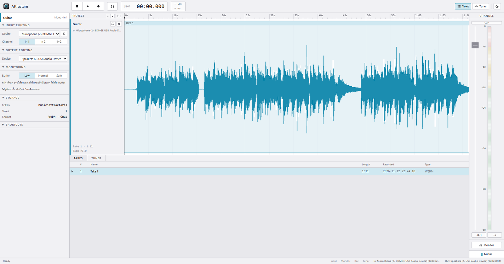
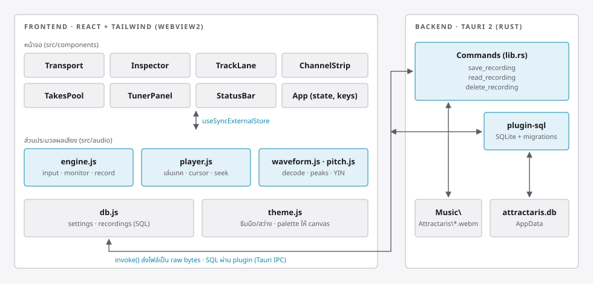
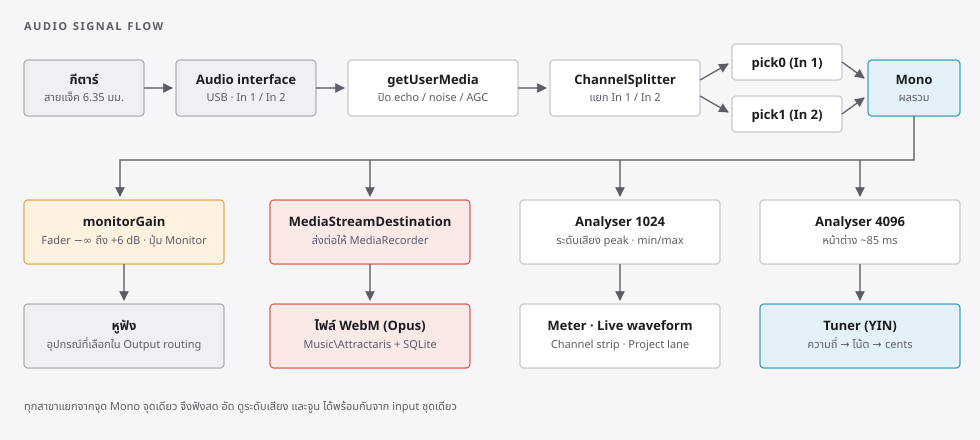

<p align="center">
  
</p>

<h1 align="center">Attractaris</h1>

<p align="center">
  โปรแกรมเดสก์ท็อปสำหรับฟังเสียงกีตาร์สด อัดเสียง และตั้งสาย ในหน้าจอเดียวแบบ DAW
</p>



---

## สารบัญ

1. [ภาพรวม](#ภาพรวม)
2. [ความสามารถ](#ความสามารถ)
3. [ส่วนต่างๆ ของหน้าจอ](#ส่วนต่างๆ-ของหน้าจอ)
4. [วิธีใช้งาน](#วิธีใช้งาน)
5. [คีย์ลัด](#คีย์ลัด)
6. [การทำงานภายในโปรแกรม](#การทำงานภายในโปรแกรม)
7. [โครงสร้างโปรเจกต์](#โครงสร้างโปรเจกต์)
8. [การติดตั้งและพัฒนา](#การติดตั้งและพัฒนา)
9. [แก้ปัญหาที่พบบ่อย](#แก้ปัญหาที่พบบ่อย)
10. [ข้อจำกัดที่ทราบ](#ข้อจำกัดที่ทราบ)

---

## ภาพรวม

Attractaris เป็นโปรแกรมสำหรับมือกีตาร์ที่ต่อกีตาร์เข้าคอมพิวเตอร์ผ่าน audio interface แบบ USB
โปรแกรมรับเสียงจาก interface แล้วทำงานได้พร้อมกันหลายอย่างจากสัญญาณชุดเดียว

- ส่งเสียงออกหูฟังทันทีระหว่างเล่น (live monitoring)
- อัดเสียงเก็บเป็นเทค พร้อมรายการเทคที่ค้นดูภายหลังได้
- แสดงระดับเสียงแบบ dBFS และ waveform
- ตั้งสายกีตาร์ด้วยจูนเนอร์ในตัว

หน้าจอออกแบบตามแนวโปรแกรม DAW อย่าง Cubase คือรวมทุกอย่างไว้ในหน้าจอเดียว มีแถบ Transport ด้านบน
แผง Inspector ด้านซ้าย พื้นที่ Project ตรงกลาง และ Channel strip ด้านขวา รองรับทั้งธีมมืดและธีมสว่าง

เทคโนโลยีหลักคือ Tauri 2 (Rust) สำหรับส่วนหลังบ้าน React 19 กับ Tailwind CSS 4 สำหรับหน้าจอ
Web Audio API สำหรับประมวลผลเสียง และ SQLite สำหรับเก็บข้อมูล

---

## ความสามารถ

| หมวด | รายละเอียด |
| --- | --- |
| รับเสียง | เลือกอุปกรณ์รับเสียงและช่อง (In 1, In 2 หรือผสม 1+2) ปิดตัวปรับแต่งเสียงพูดของระบบเพื่อให้ได้เสียงกีตาร์ที่แท้จริง |
| ฟังสด | ส่งเสียงกีตาร์ออกหูฟังทั้งสองข้าง ปรับความดังด้วย fader หน่วย dB เลือกขนาด buffer ได้ 3 ระดับ |
| อัดเสียง | อัดเป็น WAV 24-bit แบบไม่บีบอัด หรือ WebM (Opus) แบบไฟล์เล็ก บันทึกลงโฟลเดอร์ `Music\Attractaris` อัตโนมัติ เห็น waveform ระหว่างอัด |
| เล่นเทค | เล่นจากตำแหน่งใดก็ได้ คลิกที่ไม้บรรทัดเวลาเพื่อย้ายตำแหน่ง กระโดดได้ทันทีระหว่างเล่น |
| Timeline | ซูมเข้าได้ละเอียดถึง 1 มิลลิวินาทีต่อพิกเซล เลื่อนซ้ายขวา หน้าจอเลื่อนตามตำแหน่งเล่นเอง |
| จัดการเทค | ตารางรายการเทค เปลี่ยนชื่อ ลบ และเปิดดูไฟล์ในโฟลเดอร์ |
| Meter | meter แบบแบ่งช่อง สเกล 0 ถึง -60 dBFS มีขีดค้างค่า peak และไฟเตือน CLIP |
| จูนเนอร์ | จูนมาตรฐาน E A D G B E เลือกสายเองหรือให้จับโน้ตอัตโนมัติ แสดงความคลาดเคลื่อนเป็น cent |
| การตั้งค่า | จำอุปกรณ์ ช่อง buffer ความดัง และธีม ไว้ในฐานข้อมูล เปิดครั้งหน้าใช้ค่าเดิมทันที |

---

## ส่วนต่างๆ ของหน้าจอ

หน้าจอแบ่งเป็น 6 ส่วน เรียงตามภาพด้านบน

### 1. Transport (แถบบนสุด)

| องค์ประกอบ | หน้าที่ |
| --- | --- |
| ปุ่ม Stop | หยุดเล่น หรือหยุดอัดถ้ากำลังอัดอยู่ |
| ปุ่ม Play | เล่นเทคที่เลือกจากตำแหน่ง cursor |
| ปุ่ม Record (สีแดง) | เริ่มอัดหรือหยุดอัด |
| ปุ่มหูฟัง | เปิดหรือปิดการฟังสด เปิดอยู่จะเป็นสีส้ม |
| จอเวลา | แสดงสถานะ STOP / PLAY / REC และเวลาในรูปแบบ `นาที:วินาที.มิลลิวินาที` |
| ช่อง kHz / ms | อัตราสุ่มตัวอย่างเสียง (sample rate) และความหน่วงโดยประมาณ แสดงเมื่อ input เปิดอยู่ |
| ปุ่ม Takes / Tuner | สลับเนื้อหาใน Lower Zone |
| ปุ่มพระอาทิตย์ / พระจันทร์ | สลับธีมสว่างและธีมมืด |

### 2. Inspector (แผงซ้าย)

แบ่งเป็นหมวดที่พับเก็บได้

- **Input routing** เลือกอุปกรณ์รับเสียงและช่องที่เสียบกีตาร์ ปุ่มลูกศรวนใช้รีเฟรชรายการอุปกรณ์
- **Output routing** เลือกหูฟังหรือลำโพงที่ใช้ฟังสดและเล่นเทค
- **Monitoring** เลือกขนาด buffer ได้แก่ Low (หน่วงน้อยแต่อาจมีเสียงแตก), Normal (ค่าแนะนำ) และ Safe (หน่วงมากแต่เสถียร)
- **Recording** เลือกรูปแบบไฟล์ที่อัด (WAV หรือ WebM) และแสดงโฟลเดอร์ที่เก็บไฟล์กับจำนวนเทค
- **Shortcuts** รายการคีย์ลัดทั้งหมด

### 3. Project (ตรงกลางด้านบน)

พื้นที่แสดงเทคที่เลือกในรูปแบบ timeline

- ด้านซ้ายคือหัวแทร็ก "Guitar" แสดงอุปกรณ์รับเสียง ชื่อเทค และระดับการซูม
- หัวช่อง Project มีปุ่ม `-` `+` `Fit` สำหรับซูม
- ด้านบนคือไม้บรรทัดเวลา ระยะขีดปรับตามระดับซูม ตั้งแต่ทีละ 0.01 วินาทีไปจนถึงทีละนาที
- เส้นแนวตั้งที่มีหัวสามเหลี่ยมคือ cursor บอกตำแหน่งที่จะเริ่มเล่น ระหว่างเล่นจะเป็นตำแหน่งปัจจุบัน
- ระหว่างอัด จะเห็นกล่องสีแดงยาวขึ้นเรื่อยๆ พร้อม waveform ของเสียงที่กำลังเข้ามา

### 4. Lower Zone (ตรงกลางด้านล่าง)

มีสองแท็บ

- **Takes** ตารางรายการเทค แสดงลำดับ ชื่อ ความยาว วันเวลาที่อัด และชนิดไฟล์ เมื่อนำเมาส์ไปวางบนแถวจะเห็นปุ่มเปิดโฟลเดอร์และปุ่มลบ
- **Tuner** จูนเนอร์ ด้านซ้ายเป็นรายการสาย ด้านขวาแสดงชื่อโน้ต ความถี่ที่วัดได้ ความถี่เป้าหมาย ค่าคลาดเคลื่อน และแถบ cents แนวนอน

### 5. Channel strip (แผงขวา)

- **ไฟ CLIP** ติดค้างเมื่อสัญญาณแรงจนถึง 0 dBFS คลิกเพื่อรีเซ็ต
- **Fader** ปรับความดังของการฟังสด ตั้งแต่ -∞ ถึง +6 dB
- **Meter** แสดงระดับสัญญาณขาเข้า สีเขียวคือต่ำกว่า -18 dBFS สีเหลืองคือ -18 ถึง -6 และสีแดงคือสูงกว่า -6
- **ช่องตัวเลขล่าง** ซ้ายคือค่า fader หน่วย dB ขวาคือค่า peak สูงสุดที่เคยวัดได้ (คลิกเพื่อรีเซ็ต)
- **ปุ่ม Monitor** ทำหน้าที่เดียวกับปุ่มหูฟังบน Transport

### 6. Status bar (แถบล่างสุด)

ด้านซ้ายแสดงข้อความล่าสุด เช่น บันทึกเทคแล้ว หรือข้อผิดพลาด ด้านขวาแสดงสถานะ Input, Monitor, Rec, Tuner
(ตัวอักษรเข้มคือทำงานอยู่) และชื่ออุปกรณ์เข้าและออก

---

## วิธีใช้งาน

### เตรียมอุปกรณ์

1. ต่อ audio interface เข้าคอมพิวเตอร์ผ่าน USB
2. เสียบกีตาร์เข้าช่อง Input ที่รองรับกีตาร์ (มักมีป้าย INST หรือ Hi-Z) ถ้ามีสวิตช์ INST ให้เปิด
3. เสียบหูฟัง จะเสียบที่ตัว interface หรือใช้หูฟัง USB ก็ได้
4. หมุนปุ่ม Gain บน interface ไว้ประมาณกลาง

### ตั้งค่าครั้งแรก

1. ใน Inspector หมวด **Input routing** เลือกอุปกรณ์เป็น audio interface ของคุณ
2. เลือก **Channel** ให้ตรงกับช่องที่เสียบกีตาร์ ส่วนใหญ่คือ In 1
3. ในหมวด **Output routing** เลือกหูฟังที่ใช้
4. ค่าทั้งหมดจะถูกบันทึกไว้ เปิดโปรแกรมครั้งหน้าไม่ต้องตั้งใหม่

> ถ้ารายการอุปกรณ์แสดงเป็นเลข เช่น "อินพุต 1" แทนชื่อจริง ให้กดฟังสดหนึ่งครั้งเพื่ออนุญาตการใช้ไมค์ จากนั้นชื่อจริงจะปรากฏ

### ฟังเสียงสด

1. กดปุ่มหูฟัง หรือกด `M`
2. ดีดกีตาร์ ดู meter ทางขวาให้ขึ้นอยู่ในโซนสีเขียวถึงเหลือง ถ้าไฟ CLIP ติดให้ลด Gain บน interface
3. ปรับความดังในหูฟังด้วย fader ดับเบิลคลิกที่ fader เพื่อกลับไป 0 dB
4. ถ้าเสียงแตกหรือกระตุก ให้เปลี่ยน Buffer เป็น Normal หรือ Safe

ใช้หูฟังเท่านั้น ถ้าเปิดเสียงออกลำโพง เสียงจะวนกลับเข้าไมค์และเกิดเสียงหอน

### อัดเสียง

1. กดปุ่ม Record หรือกด `R` จอเวลาจะขึ้น REC และเริ่มนับเวลา
2. เล่นกีตาร์ จะเห็น waveform สีแดงเพิ่มขึ้นใน Project
3. กด `R`, `Space` หรือปุ่ม Stop เพื่อหยุด
4. โปรแกรมจะบันทึกไฟล์และเพิ่มเทคใหม่ในตาราง Takes ให้อัตโนมัติ ชื่อเทคตั้งตามลำดับ เช่น Take 5

ระหว่างอัด สามารถเปิดฟังสดไปพร้อมกันได้ แต่จะเล่นเทคเก่าไม่ได้จนกว่าจะหยุดอัด

### เล่นเทคและเลือกตำแหน่ง

1. คลิกเทคในตาราง Takes เพื่อเลือก waveform จะแสดงใน Project
2. คลิกที่ไม้บรรทัดเวลาหรือบน waveform เพื่อวาง cursor ลากค้างไว้เพื่อเลื่อนตำแหน่งได้
3. กดปุ่ม Play หรือ `Space` เพื่อเล่นจาก cursor
4. ระหว่างเล่น คลิกตำแหน่งใหม่เพื่อกระโดดไปทันที
5. กดหยุดแล้ว cursor จะค้างอยู่ที่จุดที่หยุด ถ้าเล่นจนจบ cursor จะกลับไปที่ต้นเทค
6. กด `Home` เพื่อกลับไปจุดเริ่มต้น

ดับเบิลคลิกแถวในตาราง Takes เพื่อเล่นทันที ดับเบิลคลิกที่ชื่อเพื่อเปลี่ยนชื่อ

### ซูมและเลื่อน timeline

| การกระทำ | ผลลัพธ์ |
| --- | --- |
| `Ctrl` + หมุนล้อเมาส์ | ซูมเข้าหรือออก โดยจุดใต้เมาส์อยู่กับที่ |
| หมุนล้อเมาส์ | เลื่อน timeline ซ้ายขวา |
| `H` / `G` | ซูมเข้า / ซูมออก (อ้างอิงตำแหน่ง cursor) |
| `F` หรือปุ่ม Fit | ซูมให้เห็นทั้งเทค |
| แถบเลื่อนด้านล่าง | ลากเพื่อเลื่อนตำแหน่ง |

ระหว่างเล่น หน้าจอจะเลื่อนตามตำแหน่งเล่นให้อัตโนมัติ

### ตั้งสาย

1. กด `T` หรือปุ่ม Tuner บน Transport จูนเนอร์จะเปิด input ให้อัตโนมัติ
2. เลือกสายที่ต้องการจูนจากรายการด้านซ้าย หรือเลือก Auto เพื่อให้จับโน้ตที่ใกล้ที่สุด
3. ดีดสายนั้นทีละสาย แล้วปล่อยให้เสียงค้าง
4. อ่านผล
   - เข็มอยู่ซ้ายและขึ้นว่า "ต่ำไป" ให้ขันสายให้ตึงขึ้น
   - เข็มอยู่ขวาและขึ้นว่า "สูงไป" ให้คลายสายลง
   - เข็มอยู่ในแถบกลางและขึ้นว่า "ตรงแล้ว" หมายถึงคลาดเคลื่อนไม่เกิน 5 cent

| สาย | โน้ต | ความถี่ (Hz) |
| --- | --- | --- |
| 6 | E2 | 82.41 |
| 5 | A2 | 110.00 |
| 4 | D3 | 146.83 |
| 3 | G3 | 196.00 |
| 2 | B3 | 246.94 |
| 1 | E4 | 329.63 |

---

## คีย์ลัด

| ปุ่ม | การทำงาน |
| --- | --- |
| `Space` | เล่นหรือหยุดเทค ถ้ากำลังอัดอยู่จะหยุดอัด |
| `R` | เริ่มอัดหรือหยุดอัด |
| `M` | เปิดหรือปิดการฟังสด |
| `T` | สลับแท็บ Takes และ Tuner |
| `H` | ซูมเข้า |
| `G` | ซูมออก |
| `F` | ซูมให้พอดีจอ |
| `Home` | ย้าย cursor ไปต้นเทค |
| `Ctrl` + ล้อเมาส์ | ซูมที่ตำแหน่งเมาส์ |

คีย์ลัดจะไม่ทำงานขณะพิมพ์ในช่องกรอกข้อความ เช่น ตอนเปลี่ยนชื่อเทค

---

## การทำงานภายในโปรแกรม

### สถาปัตยกรรม



โปรแกรมแบ่งเป็นสองฝั่ง

- **Frontend** ทำงานใน WebView2 เขียนด้วย React ทุกอย่างที่เกี่ยวกับเสียงทำผ่าน Web Audio API ในฝั่งนี้
- **Backend** เขียนด้วย Rust บน Tauri 2 ดูแลการอ่านเขียนไฟล์เสียงบนดิสก์ และฐานข้อมูล SQLite ผ่าน `tauri-plugin-sql`

ส่วนประมวลผลเสียงใน `src/audio` เป็นออบเจกต์ตัวเดียวที่ใช้ร่วมกันทั้งโปรแกรม (`engine`, `player`)
หน้าจอแต่ละส่วนติดตามสถานะผ่าน `useSyncExternalStore` ของ React ทำให้ทุกส่วนเห็นสถานะเดียวกันเสมอ
เช่น เมื่อกดฟังสดจากคีย์ลัด ปุ่มบน Transport, หัวแทร็ก และ Channel strip จะเปลี่ยนพร้อมกัน

### เส้นทางของเสียง



`src/audio/engine.js` สร้างกราฟเสียงชุดเดียวเมื่อมีฟีเจอร์ใดต้องใช้ input และปิดเองเมื่อไม่มีฟีเจอร์ใดใช้แล้ว

1. **รับเสียง** เรียก `getUserMedia` โดยปิด echo cancellation, noise suppression และ auto gain control
   ตัวปรับแต่งเหล่านี้ออกแบบมาสำหรับเสียงพูด ถ้าเปิดไว้จะทำให้เสียงกีตาร์ถูกบีบ โน้ตที่ลากยาวขาดหาย และความดังขึ้นลงเอง
2. **แยกช่อง** `ChannelSplitter` แยก In 1 และ In 2 ออกจากกัน แล้วผ่าน gain สองตัว (`pick0`, `pick1`)
   ตามช่องที่เลือก ค่า gain เป็น 1/0 สำหรับ In 1, 0/1 สำหรับ In 2 และ 0.5/0.5 สำหรับผสม
3. **รวมเป็นโมโน** สัญญาณจากทั้งสองช่องรวมกันที่โหนด Mono ซึ่งถูกขยายออกทั้งสองหูโดยอัตโนมัติ
   interface ส่วนใหญ่ส่งกีตาร์มาแค่ช่องซ้าย ถ้าไม่ทำขั้นนี้จะได้ยินแค่หูข้างเดียว
4. **แยกสาขา** จากจุด Mono สัญญาณถูกส่งไป 4 ทางพร้อมกัน
   - `monitorGain` ไปหูฟัง ค่าเป็น 0 เมื่อปิดฟังสด และเปลี่ยนค่าแบบนุ่มนวลเพื่อไม่ให้เกิดเสียงคลิก
   - `MediaStreamDestination` ไปยัง `MediaRecorder` เพื่ออัดเป็นไฟล์
   - `Analyser` ขนาด 1024 ใช้วัดระดับเสียงสำหรับ meter และวาด waveform ระหว่างอัด
   - `Analyser` ขนาด 4096 (ประมาณ 85 มิลลิวินาที) ใช้กับจูนเนอร์ หน้าต่างกว้างพอสำหรับคลื่นของสาย E ต่ำ

การเปลี่ยนช่องและความดังมีผลทันที ส่วนการเปลี่ยนอุปกรณ์รับเสียงหรือ buffer ต้องสร้างกราฟใหม่
ซึ่งโปรแกรมจัดการให้เอง ยกเว้นระหว่างอัด ที่จะรอให้หยุดอัดก่อนเพื่อไม่ให้เทคขาด

### ขั้นตอนการอัด

การอัดมีสองรูปแบบ เลือกได้ใน Inspector หมวด Recording

| รูปแบบ | วิธีอัด | ขนาดไฟล์โดยประมาณ | เหมาะกับ |
| --- | --- | --- | --- |
| WAV (ค่าเริ่มต้น) | AudioWorklet (`recorder-worklet.js`) ดึงเสียงดิบจากจุด Mono แล้ว `wav.js` เข้ารหัสเป็น PCM 24-bit โมโน | 8.6 MB ต่อนาทีที่ 48 kHz | นำไปมิกซ์หรือแก้ไขต่อ คุณภาพไม่ลดลง |
| WebM | `MediaRecorder` เข้ารหัสเป็น Opus | ประมาณ 1 MB ต่อนาที | ฟังย้อนหลังและซ้อม ประหยัดพื้นที่ |

ความยาวของเทค WAV คำนวณจากจำนวน sample จึงแม่นยำ ส่วน WebM ใช้เวลาจริงที่จับได้ระหว่างอัด

การอัดมีสถานะ 4 ขั้น คือ idle, starting, recording และ stopping

- **starting** คือช่วงที่กำลังเปิด input ถ้าผู้ใช้กดหยุดในช่วงนี้ จะยกเลิกการอัดโดยไม่สร้างไฟล์
  และการกดอัดซ้ำในช่วงนี้จะถูกนับเป็นการหยุด ไม่ใช่การเริ่มอัดครั้งที่สอง
- เมื่อหยุดอัด ข้อมูลเสียงถูกรวมเป็น Blob แล้วส่งให้ Rust เป็น raw bytes ผ่านคำสั่ง `save_recording`
  ไฟล์ถูกเขียนลง `Music\Attractaris\take-<เวลา>.wav` (หรือ `.webm`)
- จากนั้นเพิ่มแถวในตาราง `recordings` และตั้งชื่อตาม id ของแถว (id ไม่ถูกใช้ซ้ำแม้ลบเทคไปแล้ว ชื่อจึงไม่ซ้ำกัน)
- ถ้าบันทึกลงฐานข้อมูลไม่สำเร็จ ไฟล์และแถวที่ค้างอยู่จะถูกลบออก

### การเล่นเทค

ไฟล์ WebM ที่ได้จาก `MediaRecorder` ไม่มีข้อมูลความยาวและจุดอ้างอิงสำหรับการกระโดด
ทำให้การเล่นด้วยแท็ก `<audio>` กระโดดไปกลางไฟล์ได้ไม่แม่นยำ
`src/audio/player.js` จึงถอดรหัสไฟล์เป็น `AudioBuffer` แล้วเล่นผ่าน `AudioBufferSourceNode`
ซึ่งเริ่มเล่นจากตำแหน่งใดก็ได้อย่างแม่นยำระดับ sample

- ตำแหน่ง cursor เก็บแยกตามเทค เลือกเทคอื่นแล้ว cursor จะกลับไปที่ต้นเทค
- การกระโดดระหว่างเล่นทำโดยหยุดตัวเล่นเดิมแล้วเริ่มตัวใหม่ที่ตำแหน่งใหม่
- ถ้ากดหยุดหรือกดเล่นซ้ำระหว่างที่ไฟล์ยังโหลดไม่เสร็จ คำสั่งเก่าจะถูกยกเลิก เสียงจึงไม่เล่นซ้อนกัน
- เก็บ `AudioBuffer` ที่ถอดรหัสแล้วไว้ในหน่วยความจำ 3 เทคล่าสุด

### การวาด waveform

`src/audio/waveform.js` แปลงเสียงที่ถอดรหัสแล้วเป็นคู่ค่าต่ำสุดและสูงสุด 1000 คู่ต่อวินาที
`TrackLane` วาดไม้บรรทัด เส้นตาราง กล่องเทค waveform และ cursor ลงบน canvas ทุกเฟรม
โดยวาดเฉพาะช่วงที่มองเห็นตามตำแหน่งเลื่อนและระดับซูม จึงทำงานได้ลื่นแม้ซูมลึก
ระดับซูมสูงสุดคือ 1000 พิกเซลต่อวินาที ซึ่งตรงกับความละเอียดของข้อมูล waveform พอดี

### จูนเนอร์

`src/audio/pitch.js` ใช้อัลกอริทึม YIN หาความถี่หลักของเสียง

1. ถ้าเสียงเบากว่าเกณฑ์ (RMS ต่ำกว่า 0.01) จะไม่วัด
2. คำนวณ difference function ทีละ lag แล้ว normalize แบบ cumulative mean
3. หยุดทันทีเมื่อเจอจุดต่ำที่ต่ำกว่า 0.15 และค่าเริ่มกลับขึ้น สายเสียงสูงจึงคำนวณเร็วกว่าสายเสียงต่ำมาก
4. ปรับค่าละเอียดด้วย parabolic interpolation
5. ช่วงที่ตรวจจับได้คือ 60 ถึง 1000 Hz ครอบคลุมการจูนลงถึง Drop C

จูนเนอร์อ่านค่าประมาณ 12 ครั้งต่อวินาที ใช้ค่ามัธยฐานของ 5 ครั้งล่าสุดเพื่อให้เข็มนิ่ง
แล้วคำนวณค่าคลาดเคลื่อนเป็น cent จากสูตร `1200 x log2(ความถี่ที่วัดได้ / ความถี่เป้าหมาย)`
จากการทดสอบด้วยสัญญาณสังเคราะห์ ความคลาดเคลื่อนไม่เกิน 0.2 cent ตลอดช่วง C2 ถึง E5
และใช้เวลาคำนวณไม่เกินประมาณ 2.5 มิลลิวินาทีต่อครั้ง

### ฐานข้อมูล

ไฟล์ `attractaris.db` อยู่ในโฟลเดอร์ข้อมูลของแอป (`%APPDATA%\com.attractaris.app`)
ตารางถูกสร้างผ่าน migration ใน `src-tauri/src/lib.rs`

**ตาราง `recordings`** เก็บรายการเทค

| คอลัมน์ | ชนิด | ความหมาย |
| --- | --- | --- |
| `id` | INTEGER | รหัสเทค เพิ่มขึ้นอัตโนมัติและไม่ถูกใช้ซ้ำ |
| `name` | TEXT | ชื่อเทค |
| `path` | TEXT | ตำแหน่งไฟล์บนดิสก์ |
| `duration_ms` | INTEGER | ความยาวเป็นมิลลิวินาที |
| `mime` | TEXT | ชนิดไฟล์ `audio/wav` หรือ `audio/webm;codecs=opus` |
| `created_at` | TEXT | วันเวลาที่อัด (เวลาท้องถิ่น) |

**ตาราง `settings`** เก็บการตั้งค่าแบบ key/value ค่าเก็บเป็น JSON
ได้แก่ `inputId`, `outputId`, `channel`, `latency`, `volume` และ `theme`

### ความปลอดภัยของไฟล์

คำสั่ง `read_recording` และ `delete_recording` ฝั่ง Rust ตรวจสอบว่า path อยู่ภายในโฟลเดอร์
`Music\Attractaris` จริงก่อนทำงานทุกครั้ง หน้าจอจึงไม่สามารถอ่านหรือลบไฟล์นอกโฟลเดอร์นี้ได้
ส่วน `save_recording` รับเฉพาะนามสกุลไฟล์ที่เป็นตัวอักษรและตัวเลขเท่านั้น

### ธีม

สีทั้งหมดกำหนดเป็นตัวแปร CSS ใน `src/index.css` ธีมสว่างกำหนดค่าทับใน `:root[data-theme="light"]`
ส่วนที่วาดด้วย canvas เช่น meter และ waveform อ่านสีจากตัวแปรชุดเดียวกันผ่าน `src/theme.js`
แถบชื่อหน้าต่างของ Windows เปลี่ยนสีตามธีมผ่าน API ของ Tauri
การออกแบบตั้งใจให้เรียบ ไม่มีเงา ไม่มีแสงเรือง และไม่มีภาพเคลื่อนไหวตกแต่ง ใช้สีฟ้าจากโลโก้เฉพาะสิ่งที่ถูกเลือกหรือกำลังทำงาน

---

## โครงสร้างโปรเจกต์

```
.
├── index.html                  หน้า HTML หลักของ Vite
├── vite.config.js              ตั้งค่า Vite, React และ Tailwind
├── public/
│   └── logo.png                โลโก้ที่ใช้บนหน้าจอ
├── src/
│   ├── main.jsx                จุดเริ่มต้นของ React
│   ├── App.jsx                 สถานะหลัก การเชื่อมส่วนต่างๆ และคีย์ลัด
│   ├── index.css               ธีม สี และ utility ของ Tailwind
│   ├── theme.js                สลับธีมและส่งสีให้ canvas
│   ├── hooks.js                hook ที่ใช้ร่วมกัน และรายการอุปกรณ์เสียง
│   ├── db.js                   อ่านเขียน SQLite และเรียกคำสั่งไฟล์ฝั่ง Rust
│   ├── audio/
│   │   ├── engine.js           กราฟเสียงขาเข้า ฟังสด และการอัด
│   │   ├── recorder-worklet.js AudioWorklet ดึงเสียงดิบสำหรับอัด WAV
│   │   ├── wav.js              เข้ารหัสไฟล์ WAV 24-bit
│   │   ├── player.js           การเล่นเทค cursor และการกระโดด
│   │   ├── waveform.js         ถอดรหัสไฟล์และคำนวณ waveform
│   │   └── pitch.js            ตรวจจับความถี่ (YIN) และข้อมูลสายกีตาร์
│   └── components/
│       ├── Transport.jsx       แถบปุ่มควบคุมและจอเวลา
│       ├── Inspector.jsx       แผงตั้งค่าด้านซ้าย
│       ├── TrackLane.jsx       timeline, waveform, ซูม และ cursor
│       ├── LowerZone.jsx       แท็บ Takes / Tuner
│       ├── TakesPool.jsx       ตารางรายการเทค
│       ├── TunerPanel.jsx      หน้าจอจูนเนอร์
│       ├── ChannelStrip.jsx    meter และ fader
│       ├── StatusBar.jsx       แถบสถานะด้านล่าง
│       └── Icons.jsx           ไอคอน
├── src-tauri/
│   ├── tauri.conf.json         ตั้งค่าหน้าต่างและการ build
│   ├── capabilities/           สิทธิ์ที่หน้าจอเรียกใช้ได้
│   ├── icons/                  ไอคอนโปรแกรมทุกขนาด
│   └── src/lib.rs              คำสั่งจัดการไฟล์และ migration ของฐานข้อมูล
└── docs/images/                ภาพประกอบในเอกสารนี้
```

---

## การติดตั้งและพัฒนา

### สิ่งที่ต้องมี

- Windows 10 หรือ 11 ที่มี Microsoft Edge WebView2 (มีมากับ Windows 11 อยู่แล้ว)
- [Node.js](https://nodejs.org/) เวอร์ชัน 20 ขึ้นไป
- [Rust](https://www.rust-lang.org/tools/install) ผ่าน rustup
- Microsoft C++ Build Tools ตามที่ [Tauri กำหนด](https://v2.tauri.app/start/prerequisites/)

### คำสั่ง

```bash
# ติดตั้ง dependency
npm install

# เปิดโปรแกรมในโหมดพัฒนา (แก้โค้ดหน้าจอแล้วอัปเดตทันที)
npm run tauri dev

# สร้างไฟล์ติดตั้งสำหรับแจกจ่าย
npm run tauri build
```

การเปิดโหมดพัฒนาครั้งแรกใช้เวลาหลายนาทีเพราะต้องคอมไพล์ Rust ครั้งต่อไปจะเร็วขึ้นมาก
ไฟล์ติดตั้งที่ได้จาก `tauri build` อยู่ใน `src-tauri/target/release/bundle/`

ถ้าเปิดโหมดพัฒนาแล้วขึ้นว่า `Port 1420 is already in use` แปลว่ายังมี Vite ตัวเก่าค้างอยู่ ให้ปิดโปรเซส node ที่ใช้พอร์ตนั้นก่อน

---

## แก้ปัญหาที่พบบ่อย

| อาการ | สาเหตุและวิธีแก้ |
| --- | --- |
| ได้ยินแต่เสียงจี๋ๆ ไม่มีเสียงกีตาร์ และแตะสายหรือพื้นแล้วเสียงเปลี่ยน | กีตาร์เสียบผิดช่อง หรือแจ็คเสียบไม่สุด สิ่งที่ได้ยินคือไฟฟ้ารบกวนจากช่องที่ไม่มีสัญญาณ ตรวจช่องที่เสียบและตั้ง Channel ใน Inspector ให้ตรง |
| ได้ยินแค่หูข้างเดียว | เลือก Channel ผิด ลองสลับเป็น In 1, In 2 หรือ 1+2 |
| เสียงหอนแหลมดังขึ้นเรื่อยๆ | เสียงจากลำโพงวนกลับเข้าไมค์ ให้ใช้หูฟัง หรือปิดสวิตช์ LOOPBACK บน interface ถ้ามี |
| ฟังสดแล้วเสียงแตกหรือกระตุก | buffer เล็กเกินไป เปลี่ยน Buffer เป็น Normal หรือ Safe |
| เสียงตามมือไม่ทัน | ความหน่วงสูง ลองเปลี่ยน Buffer เป็น Low ถ้า interface มีปุ่ม Direct Monitor จะได้เสียงที่ไม่หน่วงเลย (ต้องฟังจากช่องหูฟังของ interface และปิดฟังสดในโปรแกรม) |
| ไฟ CLIP ติด หรือเสียงอัดแตก | สัญญาณแรงเกินไป ลด Gain บนตัว interface |
| meter ไม่ขยับเลย | ตรวจว่าเลือกอุปกรณ์รับเสียงถูก และสัญญาณเข้า Windows หรือไม่ โดยเปิด `mmsys.cpl` แท็บ Recording แล้วดีดกีตาร์ดูแถบระดับเสียง |
| ชื่ออุปกรณ์แสดงเป็นตัวเลข | ยังไม่ได้อนุญาตการใช้ไมค์ กดฟังสดหนึ่งครั้งแล้วกดปุ่มรีเฟรชข้างรายการอุปกรณ์ |
| จูนเนอร์ขึ้นว่า "เปิดอินพุตไม่ได้" | อุปกรณ์ถูกถอดหรือถูกโปรแกรมอื่นใช้อยู่ ตรวจการเชื่อมต่อแล้วกดปุ่ม "ลองใหม่" |

---

## ข้อจำกัดที่ทราบ

- **รูปแบบไฟล์** ไฟล์ WAV เป็นโมโน 24-bit ที่ sample rate ของอุปกรณ์ (มักเป็น 48 kHz) ยังไม่รองรับการอัดแบบสเตอริโอหรือ 32-bit float
- **ความหน่วง** การฟังสดผ่าน Web Audio บน Windows มีความหน่วงมากกว่าโปรแกรม DAW ที่ใช้ไดรเวอร์ ASIO
- **จำนวนแทร็ก** มีแทร็กเดียว ยังไม่รองรับการอัดซ้อนหลายแทร็ก
- **เอฟเฟกต์** ยังไม่มี insert effect เช่น เสียงแตก ดีเลย์ หรือรีเวิร์บ
- **ระบบปฏิบัติการ** พัฒนาและทดสอบบน Windows เท่านั้น
